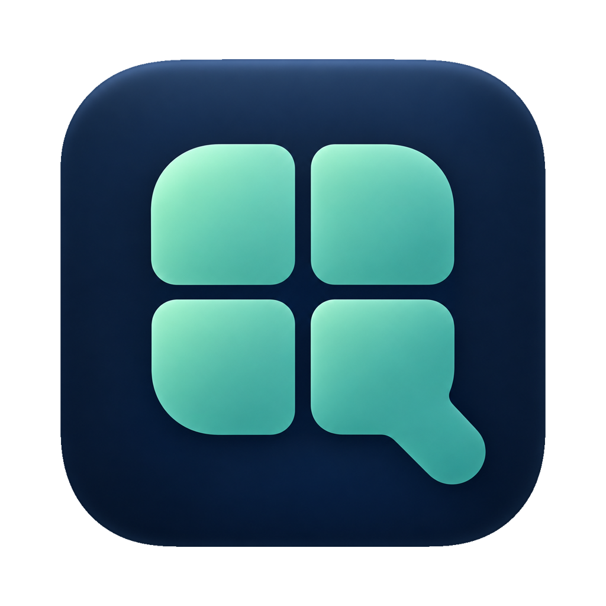
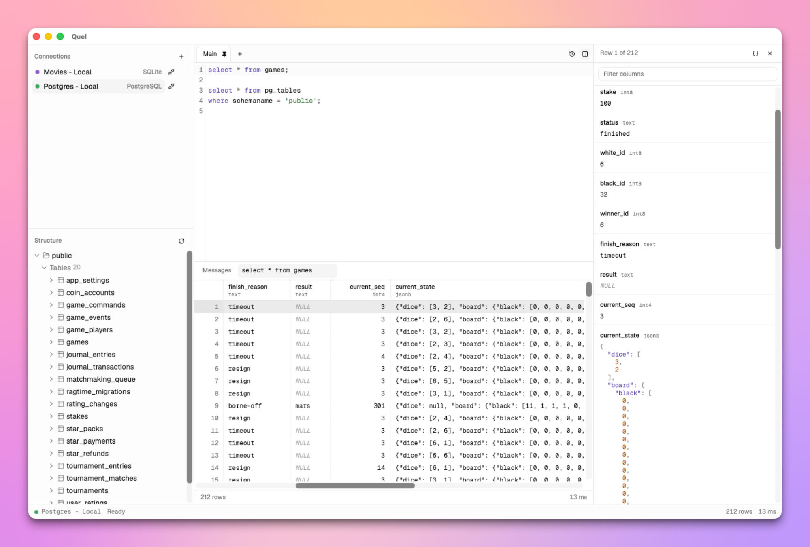

<p align="center">
  
</p>

<h1 align="center">Quel</h1>

<p align="center">A desktop database client for writing SQL and browsing database structure.</p>

<p align="center">
  
</p>

Quel is a native macOS app in the spirit of TablePlus: connect to a
database, write queries in a proper editor, and page through results of
any size without the app freezing. It is open source and in early
development.

## Features

- **Databases:** SQLite, PostgreSQL and Amazon Redshift. Redshift uses the
  PostgreSQL protocol and has not been tested against a real cluster yet.
- **Saved connections:** profiles for each database, with passwords stored
  in the macOS Keychain. Several can be connected at once.
- **SQL editor:** syntax highlighting, completion of keywords, tables and
  columns, and several tabs per connection. Tabs are saved as you type and
  restored on the next launch; closed tabs can be reopened.
- **Running queries:** run the statement under the cursor, the selection
  or the whole script. A long-running query can be cancelled.
- **Results:** a fast grid that loads rows as you scroll, several result
  tabs, and pinning to keep a result while you run others. A row's values
  open in a side panel, with JSON formatted.
- **Structure:** schemas, tables, views and columns in the sidebar.

## Install

Quel needs an Apple Silicon Mac (M1 or newer) with macOS 15 Sequoia or
later.

With [Homebrew](https://brew.sh):

```sh
brew install --cask abogoyavlensky/tap/quel
```

Or download `quel_VERSION_darwin_arm64.zip` from
[Releases](https://github.com/abogoyavlensky/quel/releases), unzip it, and
move `Quel.app` to Applications. Quel is signed and notarized, so it opens
like any other app downloaded from the internet.

### Update

```sh
brew upgrade --cask quel
```

Updates keep your connections, saved tabs and passwords.

### Uninstall

```sh
brew uninstall --cask quel
```

This removes the app and keeps your data. To remove that too, delete
`~/Library/Application Support/Quel` and the Keychain items under the
service `Quel` (Keychain Access, search for "Quel").

## Your data

Quel stores connection profiles and editor tabs in
`~/Library/Application Support/Quel/quel.db`, and connection passwords in
the macOS Keychain, never in that file. Quel has no telemetry: it talks
only to the databases you connect to.

## Status

Quel is at an early stage: the features above work, and the rest is on
the way. Next up are indexes, constraints and other structure details,
DDL export, confirmation before statements that change data, and
read-only connections. After that: DuckDB, ER diagrams, and export of
results to CSV and JSON. The full plan is in
[docs/DESIGN.md](docs/DESIGN.md).

Bug reports and ideas are welcome in
[Issues](https://github.com/abogoyavlensky/quel/issues).

## Development

Quel is written in [let-go](https://github.com/nooga/let-go), a Clojure
dialect, on [Wails v3](https://v3.wails.io), with a React frontend.

```sh
mise install       # lg, lgx, Go and Node
lgx fe-install     # frontend packages, once
lgx dev            # the app, with hot reload
```

Setup, tests and builds are in [docs/DEVELOPMENT.md](docs/DEVELOPMENT.md),
and releases in [docs/RELEASE.md](docs/RELEASE.md).

## License

[MIT](LICENSE)
